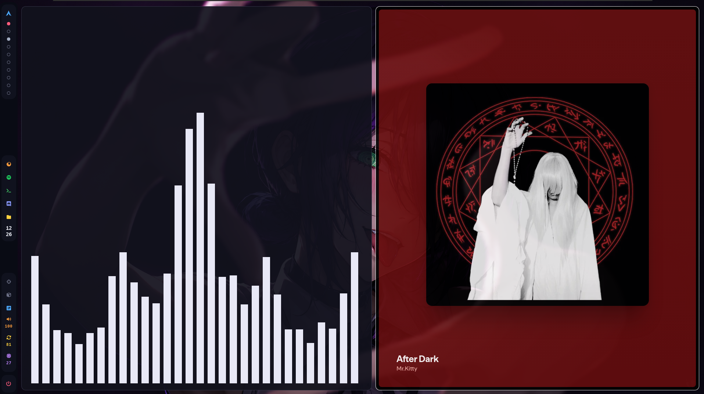
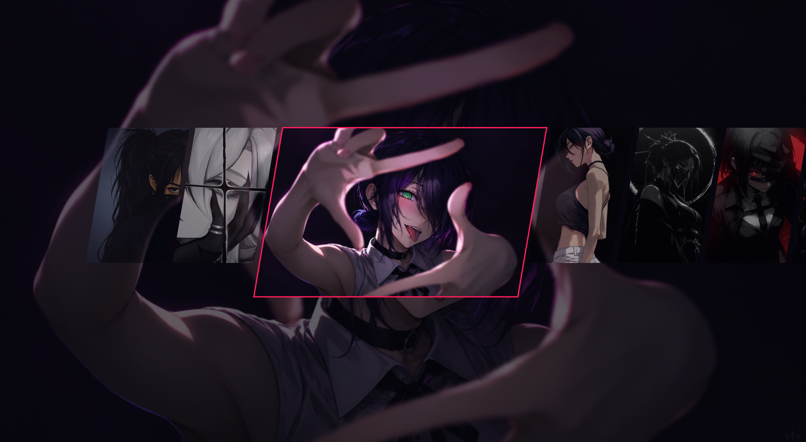
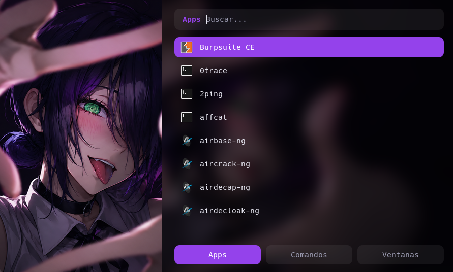
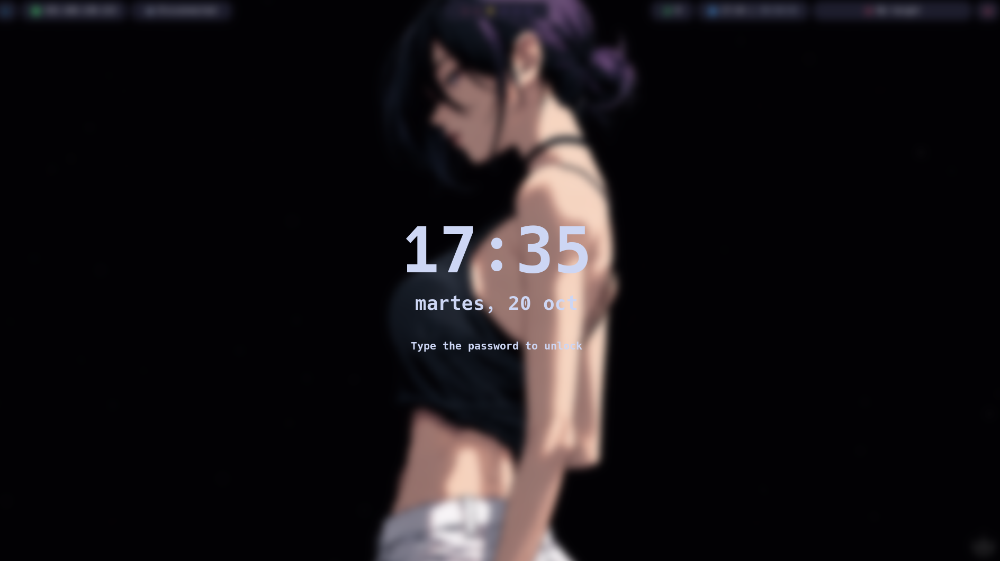

# Entorno bspwm para Parrot y Kali

bspwm + sxhkd + barra lateral vertical en Eww + picom (animaciones) + rofi + kitty + Powerlevel10k, con selector de fondos tipo carrusel, lanzador que toma el color del fondo, calendario, bloqueo de pantalla, cava, fastfetch, lsd y bat.

## Instalación

~~~bash
git clone https://github.com/k3nfa/bspwm-dotfiles.git
cd bspwm-dotfiles
./install.sh
~~~

Después cierra sesión y elige **bspwm** en la pantalla de inicio. Tu configuración anterior queda respaldada en `~/.entorno-backup-FECHA`.

Probado en Parrot Security. En una VM de VMware activa la **aceleración 3D** (si no, picom va sin animaciones).

## Atajos (Super = tecla Windows)

| Atajo | Acción |
|---|---|
| Super + Enter / Q | Abrir / cerrar terminal |
| Super + D | Lanzador (rofi), con el color de tu fondo |
| Super + W | Selector de fondos (carrusel) |
| Super + L | Bloquear pantalla |
| Super + C | Mostrar / ocultar calendario |
| Clic en el logo de la barra | Mostrar u ocultar los escritorios |
| Super + Shift + F | Firefox |
| Super + Esc | Recargar atajos |
| Super + Shift + R | Recargar entorno |
| Super + Shift + Q | Cerrar sesión |
| Super + 1-0 / Shift + 1-0 | Ir a escritorio / enviar ventana |
| Super + T / Shift + T / S / F | Encajada / pseudo / flotante / pantalla completa |
| Super + M | Monocle |
| Super + Flechas / Shift + Flechas | Enfocar / intercambiar |
| Super + Alt + Flechas | Cambiar tamaño |
| Super + Ctrl + Flechas | Mover ventana flotante |
| Super + clic izq. / der. | Mover / redimensionar con el ratón |
| Super + Ctrl + Alt + Flechas | Preselector (Espacio lo cancela, Ctrl + 1-9 su tamaño) |
| Super + Ctrl + M, luego Super + Y | Marcar ventana y enviarla al preselector |
| Esc + Esc | Añade `sudo` al comando |
| Ctrl + R / Ctrl + T | fzf: historial / archivos |

Para fijar un objetivo en la barra: `settarget 10.10.11.5 nombre` y `cleartarget`.

## Capturas

### Escritorio

Barra lateral en Eww, cava, fastfetch y Spotify con transparencia.

### Selector de fondos

Super + W abre el carrusel; Enter aplica el fondo.

### Lanzador

Super + D. La imagen y el color de acento salen del fondo que tengas puesto.

### Pantalla de bloqueo

Captura difuminada con hora y fecha (Super + L).

